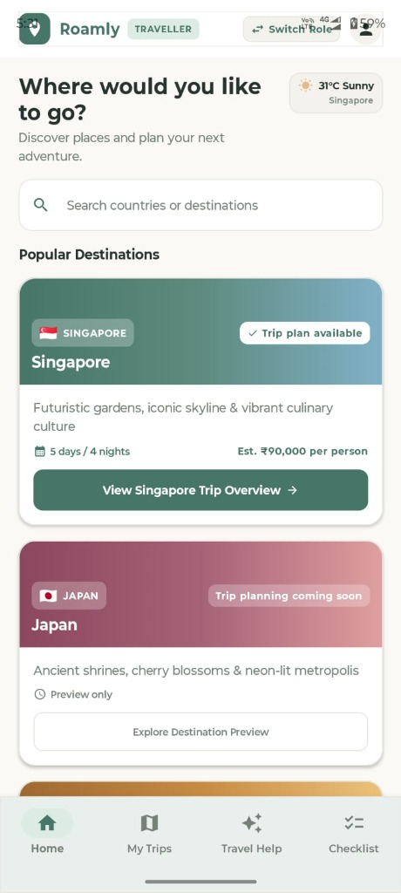
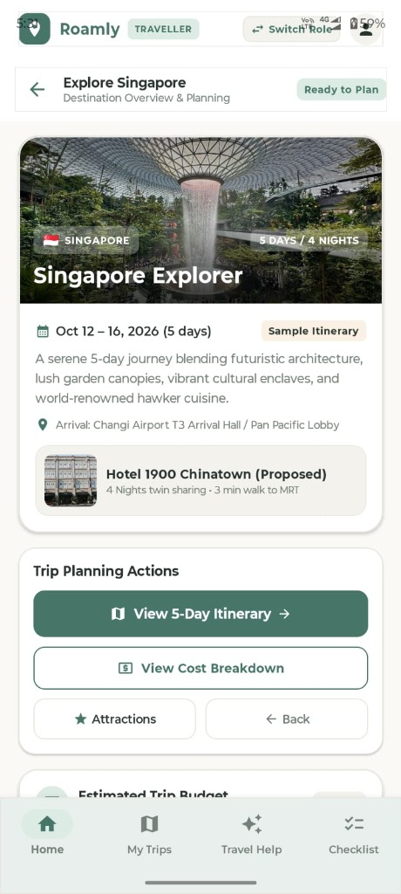
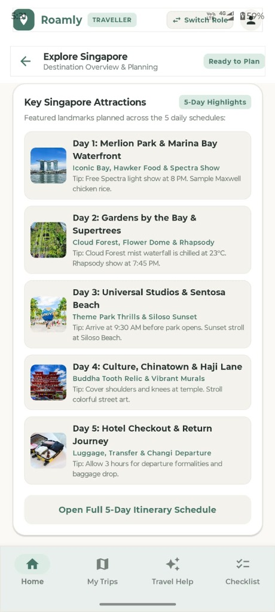
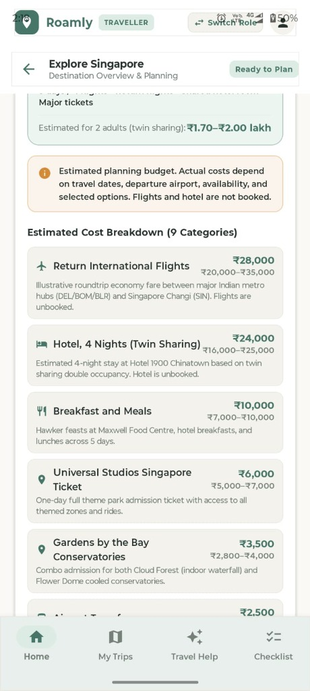
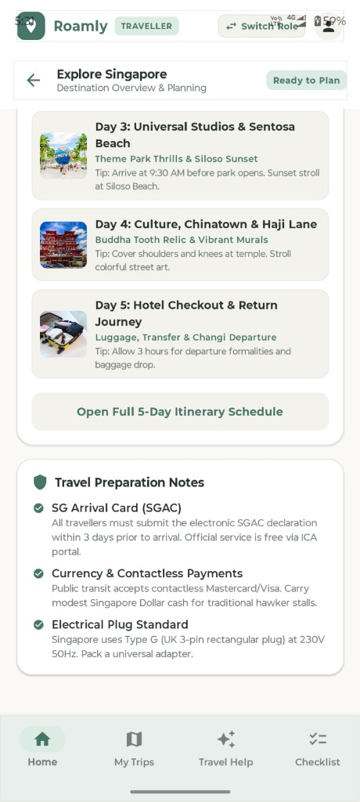
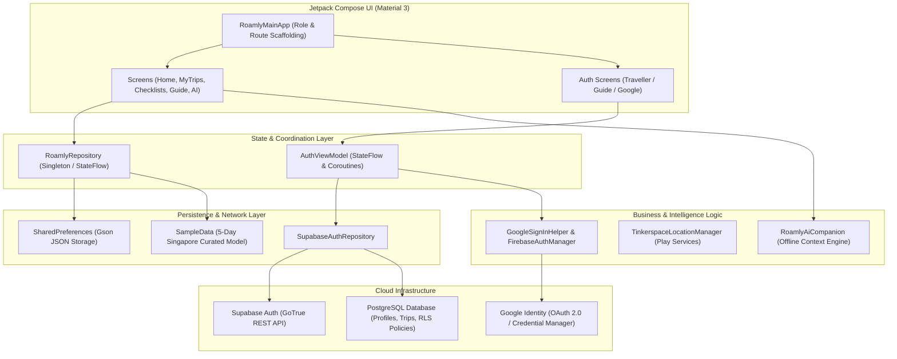

<div align="center">

# 🌿 Roamly
### *Your journey, reimagined.*

**An AI-Powered Personal Travel Companion for Seamless Journey Planning, Itineraries, and Smart Belongings Tracking**

Built for the **Layover 2026 Hackathon — Travel & Tourism Track**

[](https://developer.android.com)
[](https://kotlinlang.org)
[](https://developer.android.com/jetpack/compose)
[](https://supabase.com)
[](https://developer.android.com)
[](https://github.com/joseph489/Roamly)

<br/>


<br/>

**[✨ Key Features](#-key-features)** &nbsp;•&nbsp;
**[📱 App Showcase](#-app-showcase)** &nbsp;•&nbsp;
**[🎬 See in Action](#-see-roamly-in-action)** &nbsp;•&nbsp;
**[🎨 Design System](#-visual-design-system)** &nbsp;•&nbsp;
**[🏗️ Architecture](#-architecture--tech-stack)** &nbsp;•&nbsp;
**[⚡ Quickstart & Setup](#-getting-started)** &nbsp;•&nbsp;
**[🔐 Supabase Backend](#-supabase-backend--auth-setup)**

---

<p align="center" style="max-width: 820px; font-size: 16px; line-height: 1.7; color: #4A5568;">
<b>Roamly is your personal travel companion for planning journeys, organizing itineraries, tracking packing essentials, and getting contextual travel guidance—all in one thoughtfully designed Android experience.</b>
</p>

</div>

---

## 💡 The Problem & The Roamly Solution

Travel planning today is frustratingly fragmented. Travellers juggle flight booking apps, hotel reservation confirmations, unformatted notes, bulky PDF itineraries, and constant anxiety over misplaced passports or forgotten chargers at every hotel departure. When travelling in groups or guided tours, coordinating schedules and verifying member check-ins remains chaotic.

**Roamly replaces that friction with calm, purposeful clarity:**
- **Single Source of Truth**: Destination discovery, curated multi-day itineraries, and an itemized 9-category cost breakdown unified in one intuitive mobile experience.
- **Zero-Lost Belongings Guarantee**: A non-destructive departure reminder system prompts travellers to verify essential items (wallets, passports, keys) before vacating any attraction or accommodation.
- **Offline-First Intelligence**: A context-aware companion engine provides instant, halluncination-free local knowledge, weather tips, and transit guidance without needing constant international roaming.
- **Dual Persona Collaboration**: Role-tailored workflows provide seamless self-guided travel for individual **Travellers** and structured group coordination for verified **Tour Guides**.

---

## 📱 App Showcase

Explore actual screenshots captured directly from Roamly running on physical Android hardware:

<div align="center">

| 1. Destination Discovery | 2. Singapore Trip Overview | 3. Five-Day Itinerary |
| :---: | :---: | :---: |
|  |  |  |
| *Browse curated destinations with live weather alerts and trip availability.* | *Explore proposed hotel accommodations, trip duration, and quick planning actions.* | *Day-by-day landmark schedule with visiting tips, timing, and attraction details.* |

<br/>

| 4. Itemized Cost Breakdown | 5. Travel Preparation Notes |
| :---: | :---: |
|  |  |
| *Transparent 9-category budget breakdown covering flights, stay, meals, and tickets.* | *Official SGAC entry reminders, contactless transit advice, and electrical plug guidance.* |

</div>

---

## 🎬 See Roamly in Action

> *“From discovering a destination to organizing every day of your journey, explore how Roamly keeps travel planning simple and organized.”*

Experience the complete live user journey captured on a physical Android device (**Motorola Moto G84 5G**):

<div align="center">

<a href="docs/media/roamly-demo.mp4">
  
  <br/>
  <b>▶ Click to Watch Full Walkthrough Video (docs/media/roamly-demo.mp4)</b>
</a>

</div>

### 🧭 Walkthrough Storyboard
1. **Destination Discovery**: Searching and selecting the featured Singapore trip package from popular destinations with live Singapore weather indication (`31°C Sunny`).
2. **Trip Overview & Proposed Stay**: Reviewing the 5-Day / 4-Night package, proposed stay at *Hotel 1900 Chinatown*, and twin-sharing budget estimate (`₹1.70–₹2.00 lakh`).
3. **5-Day Interactive Itinerary**: Navigating through iconic daily attractions—from Merlion Park and Spectra light shows to the Cloud Forest mist waterfall, Universal Studios Sentosa, and Chinatown heritage walks.
4. **9-Category Transparent Cost Breakdown**: Reviewing transparent, itemized travel expenses (return international flights, hotel twin sharing, meals, admissions, MRT transit, and travel insurance).
5. **Travel Preparation & Checklists**: Accessing official SG Arrival Card (SGAC) submission windows, contactless payment options, Type-G plug standards, and non-destructive packing checkoffs.

---

## ✨ Key Features

### 🌐 1. Destination Discovery & Planning
* **Search & Filter**: Search countries and browse curated international destinations.
* **Featured Singapore Package**: Fully realized 5-Day / 4-Night Singapore journey with live destination weather and trip feasibility status.
* **Upcoming Preview Pipeline**: Preview upcoming destinations (e.g., Japan cultural tour) with planned itineraries and cost structures.

### 🗓️ 2. Personalized Trip Planning & Overview
* **Clear Timeline**: Oct 12 – 16, 2026 (5 Days / 4 Nights) sample itinerary starting from Changi Airport Arrival Hall.
* **Proposed Accommodation**: Detailed hotel proposals (*Hotel 1900 Chinatown*, 3 min walk to MRT) with twin-sharing room calculations.
* **One-Tap Planning Actions**: Instant navigation between the 5-day schedule, attractions list, and itemized budget.

### 📍 3. Curated Five-Day Itinerary Highlights
* **Day 1: Merlion Park & Marina Bay Waterfront**: Iconic bay views, Maxwell Food Centre chicken rice, and the 8:00 PM Spectra light show.
* **Day 2: Gardens by the Bay & Supertrees**: Cooled conservatories, 23°C Cloud Forest mist waterfall, Flower Dome, and Garden Rhapsody at 7:45 PM.
* **Day 3: Universal Studios Singapore & Sentosa**: Full-day theme park rides followed by a golden-hour stroll along Siloso Beach.
* **Day 4: Culture, Chinatown & Haji Lane**: Buddha Tooth Relic Temple dress-code etiquette, street art murals, and Kampong Glam boutique exploration.
* **Day 5: Hotel Checkout & Return Journey**: Baggage drop, luggage transfer, and Changi Jewel Rain Vortex before airport departure.

### 💰 4. Transparent 9-Category Cost Breakdown
* **Package Summary**: Comprehensive cost projection per person (`₹85,000–₹1,00,000`) and for 2 adults sharing (`₹1.70–₹2.00 lakh`).
* **Itemized Categories**:
  * Return International Flights (`₹20,000–₹35,000`)
  * Hotel 4 Nights twin sharing (`₹16,000–₹25,000`)
  * Breakfast and Hawker Meals (`₹7,000–₹10,000`)
  * Universal Studios Singapore Ticket (`₹5,000–₹7,000`)
  * Gardens by the Bay Conservatories (`₹2,800–₹4,000`)
  * Airport Transfers (`₹2,000–₹4,000`)
  * Local MRT & Bus Transit (`₹2,000–₹3,000`)
  * Visa Processing Allowance (`₹2,500–₹4,000`)
  * Travel Insurance (`₹500–₹1,500`)

### 🤖 5. Context-Aware AI Travel Companion
* **Offline-First Roamly Context Engine**: Deterministic, fast, and zero-hallucination assistant tuned specifically with Singapore local travel and cultural knowledge.
* **Contextual Query Support**:
  * *"What should I explore near Marina Bay?"*
  * *"What can I do with three hours free before my flight?"*
  * *"Explain the history of Singapore simply"*
  * *"What precautions should I know for temple visits?"*
  * *"Help reorganize my remaining itinerary after a delay"*
* **One-Tap Suggestion Chips**: Rapid prompt chips enable quick answers without cumbersome mobile keyboard typing.

### 🎒 6. Persistent Packing & Zero-Lost Belongings Guarantee
* **Categorized Packing Lists**: Structured into *Documents*, *Daily Essentials*, *Clothing*, *Tech & Gear*, and *Health & Toiletries*.
* **Persistent State**: Checkbox selections and custom-added items persist reliably across app restarts via `SharedPreferences`.
* **Non-Destructive Departure Checks**: Prompts travellers for a quick pocket and bag check before vacating a hotel or venue. User progress is **never** wiped or cleared on departure.

### 🛡️ 7. Practical Travel Preparation Guidance
* **Electronic SG Arrival Card (SGAC)**: Step-by-step guidance to submit the mandatory electronic declaration within 3 days prior to arrival via official ICA channels.
* **Currency & Payments**: Guidance on contactless Visa/Mastercard acceptance on Singapore public transit and cash recommendations for hawker centres.
* **Electrical Standards**: UK 3-pin Type-G rectangular plug standard at 230V 50Hz with reminders to pack an adapter.
* **Emergency Hotlines**: One-tap access to local police (`999`), ambulance (`995`), and Singapore Tourist Careline (`1800 736 2000`).

### 👥 8. Dual Persona Role System
* **Traveller Role (`TRAVELLER`)**: Instant sign-in via Email/Password or Google OAuth with automatic `approved` status for immediate access to itineraries, checklists, and AI assistance.
* **Tour Guide Role (`GUIDE`)**: Structured application flow where guide accounts start in `pending` status, preventing unauthorized access to group rosters and participant data until verified by an administrator.

---

## 🎨 Visual Design System

Roamly uses a natural, calming design language tailored for low eye-strain and comfortable mobile navigation:

* **Background**: Warm soft ivory (`#FAF9F6`) paired with crisp white card surfaces (`#FFFFFF`).
* **Primary Brand Accent**: Deep soothing sage green (`#477568`), inspired by botanic canopies.
* **Secondary Containers**: Soft mint containers (`#DCEBE4`) for subtle grouping and chip highlights.
* **Warm Accents**: Warm sand ochre (`#E7B98A`) for highlights, ratings, and warnings.
* **Typography**: Dark charcoal text (`#28332F`) with muted green-gray supporting metadata (`#748078`).
* **Geometry**: Elegant 12–16dp corner radiuses, subtle elevation, generous padding, and minimum 48dp touch targets.

---

## 🏗️ Architecture & Tech Stack

Roamly follows Android architecture best practices with single-activity navigation, reactive Kotlin StateFlow pipelines, and strict separation of concerns:



### Technology Matrix
| Layer | Technologies |
| :--- | :--- |
| **Language** | Kotlin 2.2 / 2.3 |
| **UI Framework** | Android Jetpack Compose + Material 3, Material Icons Extended |
| **Architecture** | Single Activity (`MainActivity`), MVVM + Repository Pattern, Kotlin Coroutines, `StateFlow` |
| **Local Cache** | Android `SharedPreferences` with Gson JSON serialization |
| **Cloud Backend** | Supabase Auth (GoTrue REST), PostgreSQL, Row Level Security (RLS) |
| **Identity & OAuth** | Google Credential Manager (`androidx.credentials`), Google ID, Firebase Auth |
| **Networking** | Retrofit 2, OkHttp 3, Gson |
| **Location** | Google Play Services Location (`FusedLocationProviderClient`) |
| **Build System** | Gradle 9.5.0 with Kotlin DSL (`build.gradle.kts`) |
| **Target Platforms** | Min SDK: API 26 (Android 8.0) • Target SDK: API 35 (Android 15) • Compile SDK: API 36 |

### Project Directory Tree
```
Roamly/
├── app/src/main/java/com/roamly/app/
│   ├── MainActivity.kt                      # Main Activity entry point
│   ├── ai/
│   │   └── RoamlyAiCompanion.kt             # Offline travel assistant context engine
│   ├── auth/
│   │   ├── data/
│   │   │   ├── AuthRepository.kt            # Auth repository interface
│   │   │   └── SupabaseAuthRepository.kt    # Supabase auth & profile sync repository
│   │   ├── firebase/
│   │   │   └── FirebaseAuthManager.kt       # Firebase authentication bridge
│   │   ├── google/
│   │   │   └── GoogleSignInHelper.kt        # Android Credential Manager & Google ID integration
│   │   ├── model/
│   │   │   └── AuthUser.kt                  # User, UserRole, and ApprovalStatus data models
│   │   ├── network/
│   │   │   ├── SupabaseAuthApi.kt           # Supabase Gotrue REST endpoints
│   │   │   ├── SupabaseDtos.kt              # Auth & Profile DTO models
│   │   │   ├── SupabaseNetworkClient.kt     # Retrofit client with Bearer token interceptor
│   │   │   └── SupabasePostgrestApi.kt      # PostgREST REST interface
│   │   └── ui/
│   │       └── AuthViewModel.kt             # Reactive auth ViewModel with StateFlow
│   ├── data/
│   │   ├── RoamlyRepository.kt              # Reactive StateFlow repository & local cache
│   │   └── SampleData.kt                    # Curated 5-day Singapore journey dataset
│   ├── location/
│   │   ├── TinkerspaceLocationConfig.kt     # Geo-coordinates and configuration
│   │   └── TinkerspaceLocationManager.kt    # Play Services Location provider
│   ├── model/
│   │   └── RoamlyModels.kt                  # Trip, Destination, Checklist & Message schemas
│   └── ui/
│       ├── RoamlyMainApp.kt                 # Main scaffold container, bottom nav, & role routing
│       ├── components/
│       │   ├── AuthHeader.kt                # Auth header with Roamly logo
│       │   ├── AuthTextField.kt             # Styled Material 3 text inputs
│       │   ├── BelongingsReminderDialog.kt  # Non-destructive departure belongings check
│       │   ├── GoogleSignInButton.kt        # One-tap Google sign-in button
│       │   └── PlanNewTripDialog.kt         # Custom trip creation dialog
│       ├── screens/
│       │   ├── HomeScreen.kt                # Travel companion home dashboard & destination packages
│       │   ├── MyTripsScreen.kt             # 5-Day itinerary timeline & activities
│       │   ├── AiCompanionScreen.kt         # Offline travel assistant chat interface
│       │   ├── ChecklistsScreen.kt          # Packing checklist & official travel guides
│       │   ├── ProfileScreen.kt             # Traveller profile, emergency contacts & preferences
│       │   ├── RoleSelectionScreen.kt       # Dual-persona role switcher (Traveller vs Guide)
│       │   ├── GuideDashboardScreen.kt      # Tour Guide itinerary management dashboard
│       │   ├── GuideManageTripScreen.kt     # Group trip itinerary actions
│       │   ├── GuideTravellersScreen.kt     # Group member roster & check-in management
│       │   ├── GuideTripFormDialog.kt       # Guide trip scheduling dialog
│       │   ├── TinkerspaceDemoScreen.kt     # Location demonstration & trekking simulation
│       │   └── auth/
│       │       ├── TravellerSignInScreen.kt # Traveller email/password & OAuth sign-in
│       │       ├── TravellerSignUpScreen.kt # Traveller account registration
│       │       ├── GuideSignInScreen.kt     # Guide sign-in
│       │       ├── GuideSignUpScreen.kt     # Guide application submission
│       │       ├── GuidePendingApprovalScreen.kt # Guide pending verification screen
│       │       ├── EmailVerificationNoticeScreen.kt # Email confirmation reminder
│       │       └── TravellerForgotPasswordScreen.kt # Password recovery
│       └── theme/
│           ├── Color.kt                     # Light aesthetic color tokens (#FAF9F6, #477568)
│           ├── Theme.kt                     # RoamlyTheme Material 3 light theme
│           └── Type.kt                      # Clean typography tokens
├── docs/
│   ├── images/                              # Verified documentation screenshots & hero banner
│   └── media/                               # Walkthrough video recording
├── itinerary/                               # Curated day-by-day text itineraries and expenses
└── supabase/
    └── migrations/                          # SQL schemas, RLS policies, and triggers
```

---

## ⚡ Getting Started

### Prerequisites
* **Operating System**: Windows 11, macOS, or Linux.
* **Java Development Kit**: JDK 21 (Tested on `Temurin-21.0.12.1 LTS` at `D:\jdk`).
* **Android SDK**: API 35/36 with `build-tools 36.0.0` and `platform-tools` (containing `adb.exe`).
* **Git**: Version 2.40+.

### 1. Clone the Repository
```bash
git clone https://github.com/joseph489/Roamly.git D:\Roamly
cd D:\Roamly
```

### 2. Configure Android SDK Location
Create a project-local `local.properties` file in the project root:
```properties
# Windows example:
sdk.dir=C\:\\Users\\YourUsername\\AppData\\Local\\Android\\Sdk

# macOS / Linux example:
# sdk.dir=/Users/YourUsername/Library/Android/sdk
```

### 3. Build the Application
On Windows PowerShell / Command Prompt:
```cmd
cmd.exe /c "set JAVA_HOME=D:\jdk&& gradlew.bat assembleDebug"
```
On macOS / Linux:
```bash
JAVA_HOME=/path/to/jdk-21 ./gradlew assembleDebug
```
The compiled debug APK will be generated at:
```
app/build/outputs/apk/debug/app-debug.apk
```

### 4. Run Automated Unit Tests
Roamly includes **25 automated unit tests** verifying data model serialization, travel packages, and authentication flows (`AuthSystemTest`, `RoamlyDataModelTest`, `TravellerLandingAndTripsTest`):
```cmd
cmd.exe /c "set JAVA_HOME=D:\jdk&& gradlew.bat test"
```
All 25 tests execute and pass out-of-the-box.

### 5. Install & Launch on Connected Android Device
Connect your Android phone via USB with USB Debugging enabled, verify with `adb devices`, then run:
```cmd
adb install -r app\build\outputs\apk\debug\app-debug.apk
adb shell am start -n com.roamly.app/.MainActivity
```
The application will launch immediately into the Roamly experience.

---

## 🔐 Supabase Backend & Auth Setup

Roamly integrates a production-grade authentication and authorization system powered by **Supabase Auth**, **PostgreSQL**, and **Row Level Security (RLS)**, offering distinct, role-tailored experiences for both **Travellers** and **Tour Guides**.

### 1. Dual Persona Overview
* **Traveller Portal (`TRAVELLER`)**:
  * Sign in or sign up via email & password or Google OAuth.
  * Automatically receives `approved` status.
  * Instant access to the personal 5-day Singapore itinerary, 9-category expenses, packing checklists, offline travel assistant, and belongings check.
* **Guide Portal (`GUIDE`)**:
  * Sign in or request access via email & password or Google OAuth.
  * Starts in `pending` approval status.
  * Cannot access guide dashboards, group rosters, or participant data until verified and approved by an administrator.

### 2. Supabase Project Configuration
1. **Create a Supabase Project**:
   * Visit [Supabase](https://supabase.com) and create a new project in your preferred region (e.g., `Singapore (ap-southeast-1)`).
2. **Retrieve API Credentials**:
   * In your Supabase Dashboard, navigate to **Project Settings** → **API**.
   * Copy the **Project URL** (`https://<project-ref>.supabase.co`).
   * Copy the **`anon` `public` API Key**.
   * ⚠️ **Security Warning**: Never commit or expose your `service_role` secret key. Roamly only requires the client `anon` key.
3. **Apply Database Migrations**:
   * In Supabase Dashboard, open the **SQL Editor**.
   * Execute the schema from [`supabase/migrations/20261011000001_auth_profiles_schema.sql`](supabase/migrations/20261011000001_auth_profiles_schema.sql).
   * This configures:
     * `profiles`: Linked to `auth.users(id)` with strict role and approval status constraints.
     * `trips`: Seeded with the canonical 5-day Singapore Explorer (`trip_singapore_2026`).
     * `trip_members`, `check_ins`, `announcements`.
     * `handle_new_user()` trigger: Automatically creates a user profile upon auth signup.
     * `prevent_role_escalation()` trigger: Restricts non-admin users from altering their role or self-approving.
     * Row Level Security (RLS) policies on all tables.
4. **Configure Auth Providers**:
   * In Supabase Dashboard, navigate to **Authentication** → **Providers**.
   * **Email Provider**: Enable Email signup. Toggle "Confirm email" based on your project requirements.
   * **Password Recovery**: Set Site URL or redirect URI to `com.roamly.app://auth/callback`.

### 3. Google OAuth Configuration (Credential Manager)
1. **Google Cloud Console**:
   * Open [Google Cloud Console](https://console.cloud.google.com).
   * In **APIs & Services** → **Credentials** → **Create Credentials** → **OAuth client ID**:
     * Create a **Web Application** client ID (this will be your `GOOGLE_WEB_CLIENT_ID` used by Android Credential Manager and Supabase).
     * Create an **Android** client ID:
       * Package name: `com.roamly.app`
       * SHA-1 fingerprint: Obtain using `keytool -list -v -keystore ~/.android/debug.keystore -alias androiddebugkey -storepass android -keypass android`.
2. **Supabase Google Provider**:
   * Under Supabase **Authentication** → **Providers** → **Google**:
     * Enable the provider.
     * Supply the Web Client ID and Web Client Secret from Google Cloud Console.

### 4. Local Android Project Configuration
To connect the application to your live Supabase backend, supply your credentials in `local.properties` (which is `.gitignore`d) or `gradle.properties`:
```properties
SUPABASE_URL=https://your-project-id.supabase.co
SUPABASE_ANON_KEY=eyJhbGciOi...your-public-anon-key
GOOGLE_WEB_CLIENT_ID=your-google-web-client-id.apps.googleusercontent.com
```
*Note: If these values are omitted during initial local testing, the app safely compiles with graceful fallback notices.*

### 5. Guide Verification & Administrative Approval
When a user registers as a Guide, their account is initialized with `role = 'guide'` and `approval_status = 'pending'`.

An administrator approves the guide in the Supabase Dashboard SQL Editor:
```sql
UPDATE public.profiles
SET approval_status = 'approved'
WHERE email = 'guide@example.com';
```
Once approved, tapping **"Refresh Status"** in the app immediately unlocks the full Guide Dashboard and traveller group management features.

---

## 📄 License & Attribution

* **Project**: Roamly — AI-Powered Personal Travel Companion
* **Event**: Layover 2026 Hackathon — Travel & Tourism Track
* **Repository**: [https://github.com/joseph489/Roamly](https://github.com/joseph489/Roamly)
* **Author**: Joseph ([@joseph489](https://github.com/joseph489))
* **License**: MIT License — see `LICENSE` for details.

<div align="center">
  <sub>Crafted with care for travellers who cherish thoughtful, calm, and well-organized journeys. 🌿</sub>
</div>
